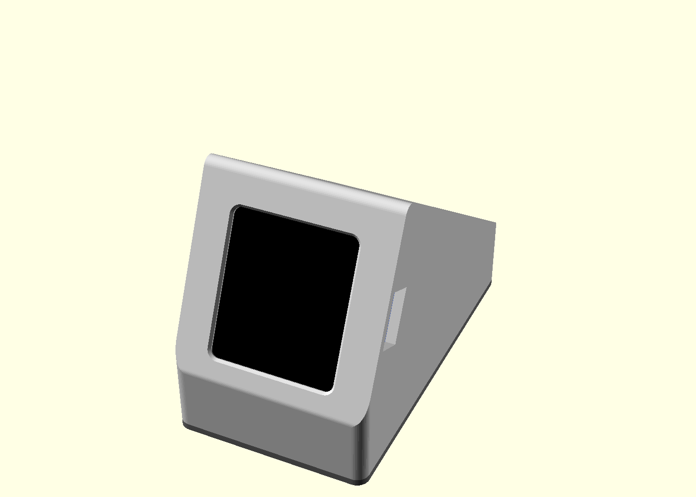
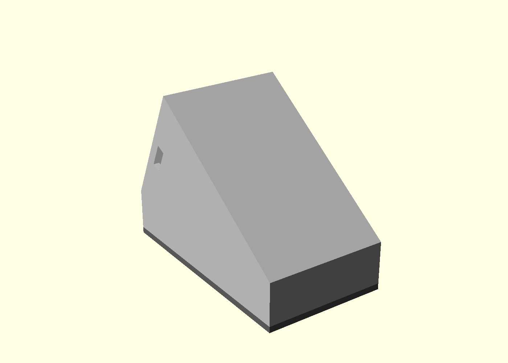
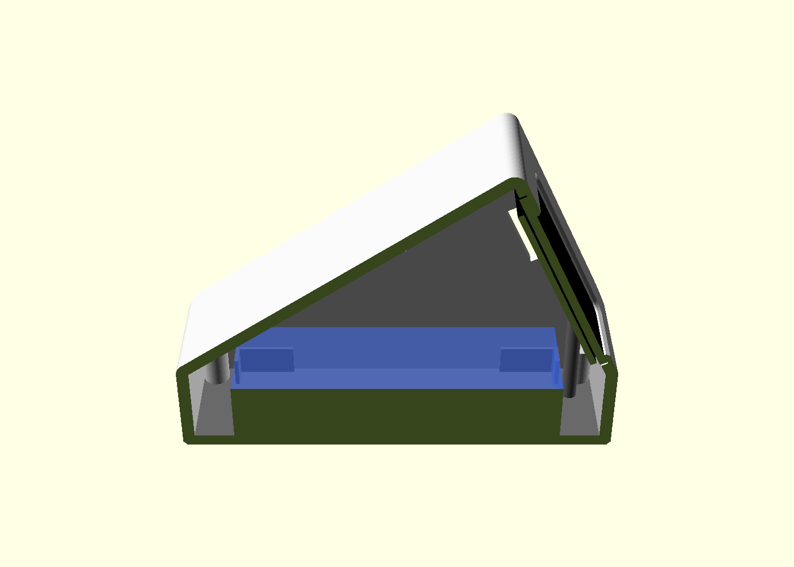
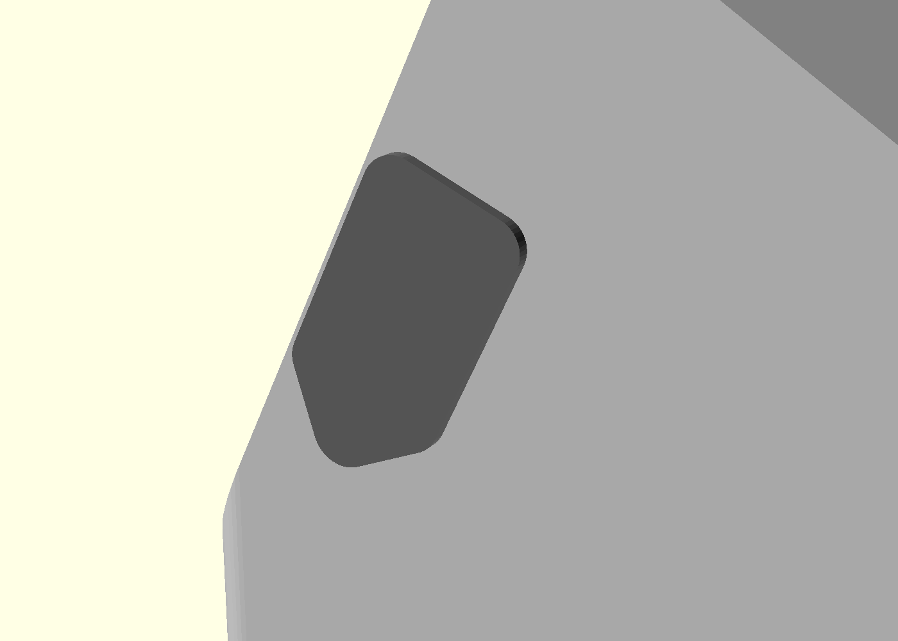

# Claude status cube: stands and pod

Two printed desk stands and a closed pod, all parametric and all checked by `test.sh`. They share the board facts and fit tunables in `board.scad` (glass, PCB, openings, `clr`, `lip_t`), so a measurement corrected there fixes all three. Each stand sets its own `board_flip` (see [Orientation](#orientation)).

The board facts come from Waveshare's STEP model of the board (`ESP32-S3-Touch-LCD-1_69.stp`, Creo export): glass 33.13 x 41.13 with r ~6.4 corners and a rounded front edge, 3.8 mm of glass and LCD, a 1.5 mm foam pad, a 1.0 mm PCB whose front face is 5.3 mm behind the glass front, and rear parts up to 10.7 mm (a vertical 2-pin 1.0 mm header; the BAT header reaches 9.8, the Type-C 9.65). The PCB has no closed mounting holes: the four "holes" are Ø2.36 notches open to the long edges. The STEP figures are the vendor's CAD, not caliper readings: measure the overall thickness and the glass-to-PCB-rear depth on your board before a full print.

- **Wedge** (`stand.scad`, below): one closed body and a base plate.
- **Easel** (`easel.scad`, see [Easel stand](#easel-stand)): a slim bezel at 65 deg on a low tray that holds the cell; screws only, every part prints flat without supports.
- **Pod** (`pod.scad`, see [Pod](#pod)): a closed, rain-proof case for the board and a 6.2 x 34 x 41 mm cell, with a Garmin-style quarter-turn boss, a desk foot and a handlebar clamp. MJF nylon and TPU from a printing service, plus a sponge gasket.

The wedge is a two-part printed desk stand for the Waveshare ESP32-S3-Touch-LCD-1.69 and a 12 x 40 x 65 mm LiPo. The board sits in a glass pocket in the sloped front face (65 deg screen angle by default), the cell lies flat in a bay behind and below it, and a base plate with two pusher posts closes the bottom and presses the board into the pocket. Everything is parametric in `stand.scad`; `test.sh` checks the geometry with boolean-intersection tests.

> **Biggest unverified risk: board retention.** The board has only two lower rear contacts (the two pusher posts on the base plate); nothing supports the upper board from behind, and the pusher/retention mechanism is NOT in `fit-check.stl`, so the fit-check cannot validate retention. Touch-time rattle or flex can only be judged on the full print. Fallbacks if it rattles: foam on the pusher tips (then set `preload = -0.8`), or add a rear pad at the roof. The posts press on the PCB around the edge notches. Against the STEP model (`test.sh`'s STEP checks) they press only the PCB and keep 0.6 mm from every part with `board_flip = true`, the wedge's default; unflipped, one passes 0.15 mm from the RST switch.





Outer envelope 47.6 x 88.44 x 59.89 mm (front shell). Every dimension marked `VERIFY` in `stand.scad` is an estimate to confirm on a real print. The preview images predate the STEP-based board (thinner board, 85.6 mm deep, unflipped) and are illustrative only.

## Print list

1. `fit-check.stl` first (1624 triangles, print time not measured): a slice of the shell around the glass pocket with both side walls. It tests glass fit, window, Type-C relief and pinholes only, not retention. The slice has no horizontal face: print it lying on its rear cut face (the large flat face opposite the glass; use the slicer's lay-on-face, which is a rotation of `tilt` = 65 deg from the modelled orientation), so the glass face and pocket point up and no supports should be needed. Printing as modelled needs supports.
2. `stand-front.stl` (3204 triangles) and `stand-base.stl` (3124 triangles).
3. `usb-cap.stl` (320 triangles), optional: the Type-C blanking cap. See below.

Settings: 0.2 mm layers, 3 perimeters, 20% infill, PLA or PETG.

- **Front shell** prints as modelled, open bottom on the bed, with supports for the interior roof and the glass-pocket ceiling (both are required). The supports sit inside the open cavity and come out through the bottom.
- **Base plate** (`base_print()`): print with the plate's bottom face (z = -plate_t, the side with the counterbores and foot recesses) on the bed and the pushers pointing up. No supports; the `plate_cham` chamfer is a 45 deg outward overhang off the bed.

## Edges

Four cosmetic radii in `stand.scad`, each independent and each `0` for the original hard-edged wedge:

| | | |
|---|---|---|
| `edge_r` | 3.0 | the four vertical corners, in plan. The shell and the base plate share it, so the two parts stay flush around the seam. The inner cavity is rounded to `edge_r - wall` so the wall keeps its full 2.4 mm through a corner (`check_wall`). |
| `prof_r` | 2.5 | apex ridge, back top edge and the kink at the foot of the face. Costs 1.23 mm of height at the apex; the glass-pocket skin still passes `check_skin`. |
| `win_cham` | 0.6 | a 45 deg break around the window, where a finger meets the screen edge. |
| `plate_cham` | 0.8 | a 45 deg chamfer under the base plate, so nothing sharp meets the desk. |

The bottom rim of the shell is deliberately left square: it is the print surface and the mating face for the plate.

## Type-C blanking cap

`usb-cap.stl` (`part="cap"`) closes the Type-C opening when nothing is plugged in. It is modelled in its
print orientation: flange face on the bed, tongues up, no supports, about a gram of filament.

Two sprung tongues reach through the wall and snap behind its inner face; the flange covers the opening
from the outside and carries a lift ear, so a fingernail pops it out. It follows `board_flip` like every
other opening, so it fits whichever wall the port ends up on.



| | | |
|---|---|---|
| `cap_clr` | 0.15 | clearance into the opening, per side |
| `cap_barb` | 0.45 | snap ridge, per side; `cap_barb - cap_clr` = 0.3 mm of it engages behind the wall |
| `cap_wall` | 0.8 | tongue thickness: this is what flexes, so thinner is softer |
| `cap_flange` | 1.6 | how far the flange stands past the opening, per side |
| `cap_lip` | 0.9 | flange thickness: how far it stands proud of the wall |
| `cap_ear` | 2.2 | radius of the lift ear |
| `cap_land` | 1.0 | how far the tongues reach past the inner wall face |

The fit is **unverified on a print**, and it inherits every `VERIFY` in the Type-C relief: the cap is sized
from `usb_plug_w` x `usb_plug_h`, so if you change those after measuring your plug, the cap follows. Print
it with the fit-check coupon and try it in that first: too tight to start, raise `cap_clr`; falls out,
raise `cap_barb` or lower `cap_clr`; too stiff to push in, lower `cap_wall`.

The geometry tests check that the tongues pass through the opening with clearance, that the barbs really
do reach past the inner wall face, that the flange covers the opening and seats on flat wall, and that
nothing touches the board, each with a control that must fail.

## Hardware

- 4 x M2 x 6 self-tapping screws (an M2 x 8 bottoms out at the pilot) (or heat-set inserts with `insert_mode = true`)
- 4 rubber feet, 8 mm
- optional 1 mm foam tape on the pusher tips (then set `preload = -0.8`)

## Assembly order

1. Connect the battery to the board before closing (see the polarity warning).
2. Set the board into the glass pocket from behind, glass first.
3. Screw on the base plate; the pushers press the board's lower edge into the pocket.
4. Stick on the feet.

## Fit-check procedure

Print `fit-check.stl` and check:

- the glass drops in without force: if tight or loose, adjust `clr` (and `glass_a`, `glass_b`, `glass_r`);
- the window leaves the touch area clear: `act_a0`, `act_b0`, `win_margin`;
- the Type-C plug seats: the slot (`usb_a`, `usb_w`, `usb_h`) is surrounded by a plug relief (`usb_plug_w` x `usb_plug_h` = 13 x 7.5 mm, VERIFY) cut through the wall starting `usb_plug_x0` = 3 mm beyond the PCB edge, so the overmold can reach within a few mm of the board edge (the PCB edge is about 8.9 mm from the outer wall, the wall is 2.4 mm thick). Measure your plug and adjust `usb_plug_w`, `usb_plug_h`, `usb_plug_x0`;
- a paper clip reaches RST / BOOT / PWR through the pinholes: `btn_a`, `btn_y`, `pin_d`;
- the tallest rear part clears: `board_t`.

The opening positions (Type-C slot, buttons) and the board dimensions come from the STEP model; the plug relief and the button order (RST / BOOT / PWR) are still `VERIFY` items: check them on the fit-check print, edit the values, and re-run `./test.sh stand` after every edit. Also check the battery position against the board's chip antenna (see Antenna).

## Orientation

In the unflipped board frame (the STEP model, turned 180 deg in-plane so its button positions match `btn_a`), the Type-C and the BAT header are on the right edge and RST / BOOT / PWR on the left. `board_flip = true` rotates the board 180 deg in its pocket and swaps the openings to the opposite walls. No firmware change is needed either way: the cube reads its IMU and turns the picture the right way up on its own.

Each stand sets `board_flip` itself, because the right choice differs:

- **Wedge** (`stand.scad`): `true`, so the Type-C and the battery connector are on the **left** wall and the buttons on the right. Unflipped, a pusher post passes 0.15 mm from the RST switch. Flipped, the posts sit further back, so the front end zone grows to keep them at least 1 mm (`push_gap`) in front of the battery bay: 88.44 mm deep at tilt 65 (88.37 unflipped, 89.1 at tilt 55).
- **Easel** (`easel.scad`): `false`, so the Type-C is on the right. Flipped, the active area sits 2.55 mm higher in the bezel and the centre-press tip force drops to 2.76 N, under the 3.0 N the tests require.

Re-export the STLs after changing either.

## Battery polarity warning

MX1.25 connector pinouts vary by vendor. Compare the battery lead against the `+` / `-` marks on the board before connecting; a swapped pair can destroy the board or the cell. The battery pocket is 65.8 x 40.8 x 12.8 mm and the LiPo must not be compressed: do not force a thicker cell in, and do not let the lid or the base squeeze it.

## Antenna

The battery and its metal pouch must not sit over the board's chip antenna. The STEP model has a 6 x 2 x 1 mm part on the PCB rear at the board's short edge, on the buttons' side (unflipped board x 7.6..13.6, z 2.0..4.0), which is probably the antenna; the stands do not model it, so the bay position relative to it is **unverified**: before closing the stand, locate the chip antenna on the board and confirm physically that the battery does not sit over it. The body is plastic only.

## Tests and regenerating

`./test.sh` (all three; `./test.sh stand`, `./test.sh easel` or `./test.sh pod` for one; uses Docker via `tools/openscad`, override with `OPENSCAD=...`) must exit 0. Export:

```sh
tools/openscad --backend=manifold -D 'part="front"' -o stand-front.stl stand.scad   # also part="base", part="fit", part="cap"
python3 tools/stlcheck.py stand-front.stl
```

The STEP checks (`STEP` in the output) also run every printed part, in place, against Waveshare's STEP model of the board instead of the box ghost: no overlap with any of its 291 solids, at least 0.2 mm from every rear part, and the pushers / shoulders overlap the PCB (the preload) and nothing else. `tools/stepcheck.py` meshes the STEP once into `build/board-step.npz` and needs Python packages the rest does not; without them, or without `ESP32-S3-Touch-LCD-1_69.stp`, `test.sh` prints `SKIP STEP checks` and goes on. Set them up once:

```sh
python3 -m venv build/stepvenv && build/stepvenv/bin/pip install cadquery-ocp manifold3d trimesh scipy numpy   # or STEP_PY=<python with them>
```

The tightest fits against the STEP model: the easel carrier 0.29 mm from the 2-pin header (the tallest rear part, 10.7 mm), the easel bezel 0.63 mm from the Type-C shell, the wedge pushers 0.6 mm from a side switch.

Previews were rendered headless with `--render` and `xvfb-run` (installed with apt inside the Docker image; not scripted here), using `part="assembly"` / `part="section"` / `part="cap_fitted"` with a section camera rotated 270 deg about z. They are illustrative and not reproducible from this repo alone.

## Easel stand

`easel.scad`. The board stands at 65 deg (`tilt`) in a slim bezel, held from behind by a carrier that stands on the lid of a low tray; the 12 x 40 x 65 mm cell lies flat in the tray, mostly behind the screen. Assembled envelope 46 x 81 x 67.8 mm. Same constraints as the wedge: the whole active area open, Type-C reachable (plug relief plus an optional cap), RST / BOOT / PWR through pinholes, plastic only near the antenna, no supports.

### Print list

| File | Part | Print orientation |
|---|---|---|
| `easel-tray.stl` | tray, 46 x 81 x 15.2, battery bay, screw pilasters, Ø8 foot recesses | open side up |
| `easel-frame.stl` | 2.4 mm lid with a lightened centre fin that backs the carrier | lid down |
| `easel-carrier.stl` | 3.2 mm back plate with a groove for the battery lead, four posts (shoulders press the PCB, pegs locate it in its edge notches), two legs with hinge ridges | rear face down |
| `easel-bezel.stl` | glass pocket and window, open chin with hinge grooves, Type-C relief, pinholes | front face down |
| `easel-usb-cap.stl` | optional Type-C blanking cap (crush ribs) | flange down |

**Print the carrier first** and press the real board onto its pegs before printing the rest: the notch positions come from the STEP model, not a measured board. If the pegs miss, set `peg_l = 0`; the shoulders still press the PCB, though only the rim around each notch (about 7 mm² in all).

### Hardware

Self-tapping M2 into Ø1.8 pilots, no glue: 2 x M2 x 10 (legs), 1 x M2 x 8 (rear of the lid), 2 x M2 x 6 (top of the bezel, from the carrier's rear). 4 x Ø8 rubber feet.

### Assembly order

1. Cell into the tray, tab end forwards; thread the lead up through the lid slot on the board's connector side.
2. Frame on; fit the rear M2 x 8.
3. Carrier on the lid; two M2 x 10 down through the legs clamp carrier, lid and tray in one go. These go in **before the board**: once the board and bezel are on, the leg screws are covered.
4. Plug the lead into the board's BAT header (it sits beside the Type-C, nearer the board's bottom end, and is assumed to open towards the board centre, so the lead leaves across the PCB rear). Lay the lead in the groove in the carrier's front face: across, down past the lower post, out under the board edge and down beside the leg to the slot. Then press the board onto the pegs, glass outwards, without pinching the lead.
5. Hold the bezel tilted forward with its front-bottom edge on the lid and swing it back over the glass: the grooves in its chin pick up the ridges on the legs.
6. Two M2 x 6 from the carrier's rear into the bezel.

To get at the board or the lead later, take out the two top screws and swing the bezel off.

### Hinge

Ridges and grooves are arc bands concentric with the bezel's front-bottom edge (the hinge line), so swinging the bezel about that edge slides each groove along its ridge and nothing else meets. Closed, the ridges stop the chin lifting or sliding forward and the grooves locate it sideways. The lower corners of the glass pocket are square behind the glass on purpose: round ones sweep into the glass and PCB corners during the swing. The tests swing it 5, 10, 20 and 30 deg with the board nominal and sagged 0.2 mm on its pegs. Clearances are 0.2 mm in printed plastic; if it binds, sand the ridges.

### Stability

`tools/stability.py` estimates mass, centre of gravity and the push into the screen that tips the stand backwards, from the parts in place (PLA at 1.24 g/cm³ x 0.9 solidity, 55 g cell, 12 g board, pivot 1 mm inside the rear feet). Nominal: 112.7 g; 3.28 N at the centre of the active area, 1.49 N at its top edge (`test.sh` requires 3.0 and 1.3). Estimates, not measurements.

### VERIFY (easel-specific, on top of the board items in `board.scad`)

- PCB notch positions (the pegs): from the STEP model, averaged end to end (3.13 and 3.26 mm from the PCB ends).
- The MX1.25 BAT header and the lead route (`bat_x`, `bat_z`, `bat_h`, `bat_w`, `bat_plug`, `bat_exit`). The header's position and height are from the STEP model (`bat_z` = 10.5, beside the Type-C towards the bottom end); which way it opens and how far the mated plug stands out are not, and `bat_w` = 5 is a 2-pin MX1.25 plug, not the header with its solder tabs. `check_cord` runs the plug and a Ø1.6 lead from the header through the groove (`cord_x`, `cord_w`, `cord_depth`) to the lid slot, clear of every part. It treats everything on the PCB rear as reaching `board_t`, except the header and `bat_exit` mm past the plug, where the lead climbs into the groove. If a tall part sits in that run, move `cord_x`.
- Which end of the cell the tabs leave from (assumed: the front).

`board_flip` works here too (but see [Orientation](#orientation)) and needs no firmware change. Export:

```sh
tools/openscad --backend=manifold -D 'part="carrier"' -o easel-carrier.stl easel.scad   # also tray, frame, bezel, cap (-> easel-usb-cap.stl)
python3 tools/stability.py build/easel   # after ./test.sh easel has rendered the at_* parts
```

There are no easel preview images (no headless PNG export here); `part="assembly"` and `part="section"` render the parts in place for viewing in OpenSCAD.

## Pod

`pod.scad`, designed in `docs/superpowers/specs/2026-10-24-pod-design.md`. A closed case for the board and a 6.2 x 34 x 41 mm cell that lives on the desk next to the monitor and goes on the bike when needed, in the rain too. The cell sits behind the board, shifted along the long axis so nothing metal is over the chip antenna (see [Antenna](#antenna)), with 5 mm of extra bay length (`bat_buf`, 3..5) for a protection board at the lead end (`lead_end = "bottom"` or `"top"`). A quarter-turn boss on the back locks into the desk foot or the bar clamp; store-bought Garmin mounts should take it too (`VERIFY`). No button holes: the board stays on, and RST / BOOT / PWR are reached by opening the case. No sound hole either, so the buzzer is muffled.

Envelope: 40.8 x 63.5 mm, 26.5 mm from the face to the back (tub 23.5, plate and squeezed gasket 3.0), plus 5.0 for the boss. `part="meta"` echoes the tub's figures.

### Print list

Printed by a service: rigid parts in **MJF PA12**, the plug in **TPU** (or a ready-made rubber plug). The gasket is **1.5 mm closed-cell silicone sponge**, cut to `pod-gasket.dxf`: about 700 mm² of it is squeezed, and sponge takes some 15–25 N for that, which four M2 screws and the carrier can carry. Solid TPU would need hundreds of newtons and bow the carrier into the cell. MJF needs no supports, so orientation is the service's choice.

| File | Part | Material | Qty |
|---|---|---|---|
| `pod-tub.stl` | rear shell: board pocket, carrier ledges, cell bay, four blind pilots, Type-C opening, tether anchor, quarter-turn boss | PA12 | 1 |
| `pod-plate.stl` | front plate: window, four countersinks, skirt that sets the gasket squeeze | PA12 | 1 |
| `pod-carrier.stl` | carrier: four posts press the PCB, Ø1.95 pegs in its notches, lead groove and a slot open to the edge | PA12 | 1 |
| `pod-gasket.dxf` (`pod-gasket.stl` as a 3D reference) | gasket over the glass border and the rim | 1.5 mm closed-cell silicone sponge, cut | 1 |
| `pod-plug.stl` | Type-C plug with a strap and a pin into the anchor | TPU | 1 |
| `pod-foot.stl` | desk foot, 20 deg lean, quarter-turn receiver | PA12 | 1 |
| `pod-clamp-top.stl`, `pod-clamp-bottom.stl` | handlebar clamp for a 31.8 mm bar, receiver on top | PA12 | 1 each |
| `pod-shim-25.stl`, `pod-shim-22.stl` | half-tube shims for 25.4 / 22.2 mm bars | PA12 | 2 of the size you need |
| `pod-qt-boss.stl`, `pod-qt-receiver.stl` | quarter-turn test pair | PA12 | 1 each |

**Order first:** `pod-qt-boss`, `pod-qt-receiver` and `pod-carrier`. Check the boss against a cheap store-bought Garmin quarter-turn mount and against the test receiver (it should drop in landscape, turn 90 deg, click and not lift out), and press the real board onto the carrier's pegs. Only then order the rest.

### Hardware

4 x M2 x 8 countersunk (front plate into the tub's pilots), 2 x M3 x 16 and 2 x M3 nuts (clamp), a 1.5 mm adhesive foam pad the size of the cell (behind it; the bay squeezes it to 1.0, at least 0.3 even with the cell pushed forward), 4 x Ø8 rubber feet (foot), a cheap Garmin quarter-turn mount (to check the boss). Without a protection board in the buffer, fill it with a 5 mm foam block so the cell cannot slide.

### Assembly order

1. Foam pad on the back of the bay; cell in, with its lead and protection board at the `lead_end` end of the bay (default: the bottom).
2. Lay the lead into the carrier's slot from its open edge (the plug cannot pass a slot), then the carrier into the cavity, rear face on the two ledges. Spare lead folds into the buffer beside the protection board.
3. Plug the lead into the board's BAT header (beside the Type-C, opening towards the board centre) and lay it in the carrier's groove.
4. Press the board onto the carrier's pegs, glass outwards: the glass front ends flush with the rim.
5. Gasket on, then the plate; four M2 x 8 countersunk screws, evenly, until the plate's skirt meets the rim.
6. Plug into the Type-C opening, pin into the blind anchor hole 6 mm below it.

### Seal

One flat gasket does all the sealing. The glass front and the tub's rim are in one plane (y = 0), and the plate squeezes the gasket on both, from 1.5 to 1.0 mm (`gk_t`, `gk_sq`); the plate's skirt lands on the rim and stops the squeeze there. The 0.5 squeeze covers the board sitting 0.35 back (tolerance plus the carrier bowing under the gasket's load, checked). Every way into the cavity crosses at least 1.0 mm of squeezed gasket (`seal_land`, checked): from a screw hole (the pilots and the tether anchor are blind, so water down them goes nowhere else), from the seam at the side, and from the window across the glass border to the glass edge. The pod window has r = 3 corners for that last one (board.scad's r = 2 leaves 0.84); with the board off by its root-sum-square play (±0.35 in x and z: pegs, carrier, plate on its screws) at least 0.7 is left. The Type-C opening is closed by the plug's body, 0.15 mm oversize per side (`plug_int`, `VERIFY`), in a relief that keeps a 0.8 web to the cavity. Rain and road spray, not dunking.

### Desk and bike

On the desk, the foot holds the pod 20 deg back from vertical (`foot_lean`), clear of the desk, with nothing of the foot past the pod's sides: a USB-C cable plugs into the side while it stands there, and the open plug hangs below the opening, clear of the cable. On the bike the clamp holds it flat on top of the bar, long side across the bar. Either way it locks in both portrait orientations (chin up or down); the cube's IMU turns the picture. Charge by cable after a ride, never with a cable plugged in while riding.

**Power with no button (`VERIFY`):** the case has no button access, so after the cell runs flat, plugging in USB has to start the board without PWR. The PWR / SYS_EN power-hold circuit is not documented for this; if it does not start, open the case and press PWR.

### Checks

`./test.sh pod`, on top of the board checks shared with the stands. With the board's STEP model: the carrier presses only the PCB and keeps 0.29 mm from the tallest rear part (the 2-pin header), the tub 1.17 mm from the Type-C shell, the plug 1.89 mm. The quarter-turn checks insert, the turn, the lock, retention when pulled 0.5 mm, and the detent: a dome on a 6 mm finger (root strain 1.3% for its 0.4 rise, under 2%) that presses 0.05 into a round dimple when locked, so the boss is held against the hooks and the dimple's walls cam it out when turned; the foot checks the pod against the foot and the desk, the cable and the open plug, and that the pod's centre is 5 mm inside the base, both ways up.

### VERIFY (pod-specific, on top of the board items in `board.scad`)

- The antenna position (`ant_*` in `board.scad`): the 6 x 2 x 1 mm STEP part assumed to be the chip antenna. The bay starts `ant_keep` = 3 past it; every metal part (cell, buffer, lead, screws) keeps `metal_keep` = 2 off its footprint.
- Every quarter-turn dimension (`qt_*`). No published Garmin drawing was found, so these are starting values; the pod's own receivers use them too, so the pod fits its foot and clamp either way. Check against a real mount on the test pair.
- The BAT header and the lead route (`bat_*`, `cord_*`), as in the easel; which end of the real cell the lead leaves from, and the protection board's length (`lead_end`, `bat_buf`).
- `plug_int` (the plug's grip in the opening), the gasket squeeze, and the detent's click (`qt_detent`, `qt_notch`) on the first print.
- USB starting the board after a flat cell (above).

Export:

```sh
tools/openscad --backend=manifold -D 'part="tub"' -o pod-tub.stl pod.scad   # also plate, carrier, gasket, plug, foot, clamp_top (-> pod-clamp-top.stl), clamp_bottom, shim_25, shim_22, qt_test_boss (-> pod-qt-boss.stl), qt_test_receiver
tools/openscad -D 'part="gasket_2d"' -o pod-gasket.dxf pod.scad
```

`part="assembly"`, `"section"`, `"on_foot_view"` and `"on_bar_view"` render the pod in place for viewing.
